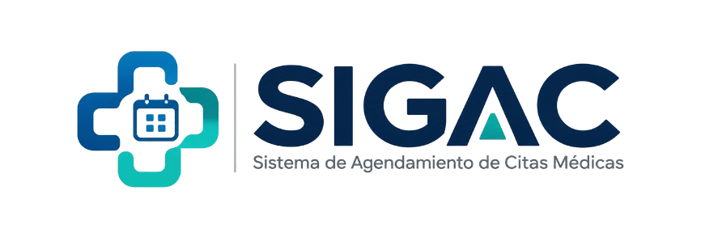
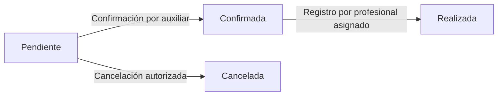
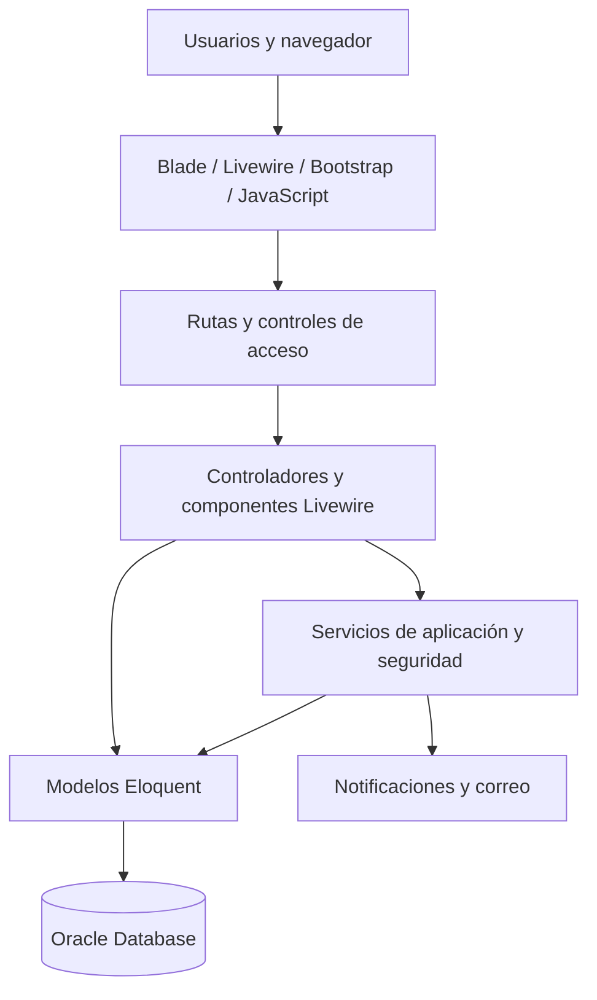
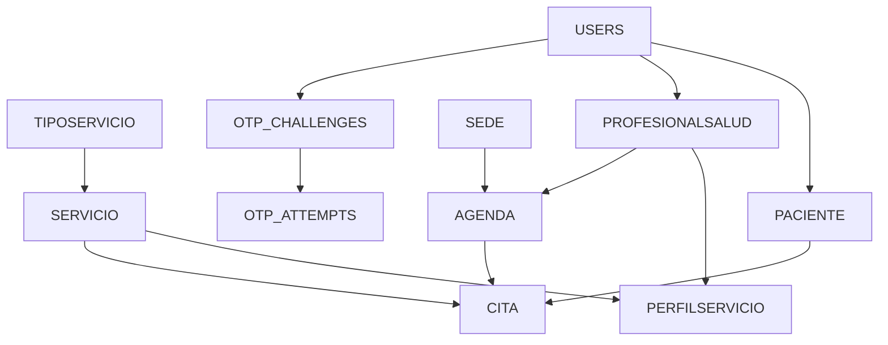

<p align="center">
  
</p>

# SIGAC — Sistema Integral Web de Gestión, Automatización y Agendamiento de Citas

**Aplicación web para centralizar la gestión administrativa, la disponibilidad de profesionales y el agendamiento de citas médicas.**


**Estado:** consolidación funcional, fortalecimiento de seguridad y validación progresiva.

**Último hito de desarrollo:** renovación de autenticación, perfiles e interfaces de los cuatro roles, protección del historial tras el cierre de sesión, edición de sedes y validación automatizada (noviembre de 2026).

**Versión objetivo:** SIGAC 1.0 — diciembre de 2026; todavía no corresponde a una versión liberada para producción.

**Origen:** proyecto formativo del Tecnólogo en Análisis y Desarrollo de Software (ADSO), SENA.

## Contenido

- [Descripción y alcance](#descripción-y-alcance)
- [Funcionalidades por rol](#funcionalidades-por-rol)
- [Autenticación y seguridad](#autenticación-y-seguridad)
- [Reglas del negocio](#reglas-del-negocio)
- [Arquitectura y organización](#arquitectura-y-organización)
- [Modelo de datos](#modelo-de-datos)
- [Tecnologías](#tecnologías)
- [Instalación local](#instalación-local)
- [Pruebas y calidad](#pruebas-y-calidad)
- [Estado y hoja de ruta](#estado-y-hoja-de-ruta)
- [Documentación y autoría](#documentación-y-autoría)

## Descripción y alcance

SIGAC busca reducir la fragmentación de los procesos administrativos de agendamiento mediante una plataforma que relaciona pacientes, profesionales de salud, servicios, sedes, agendas y citas. El paciente puede consultar disponibilidades y gestionar sus reservas, mientras que los perfiles internos administran los recursos y las operaciones que les corresponden.

El sistema propone una alternativa a los procesos manuales y a la coordinación dispersa de solicitudes, con un modelo relacional, reglas de negocio explícitas, controles de acceso y una interfaz web adaptable a diferentes dispositivos.

### Origen y contexto

El proyecto surgió de un ejercicio académico de investigación y diagnóstico en el contexto de Laboratorios Carvajal IPS S.A.S. Este antecedente constituye un caso de estudio, no una relación comercial, contractual o institucional vigente.

SIGAC es un proyecto independiente, adaptable a diferentes organizaciones que gestionen citas. No representa a dicha IPS, no es su producto oficial ni se desarrolla actualmente por encargo de una institución prestadora de salud.

El alcance actual es administrativo y operativo. No sustituye una historia clínica electrónica, un sistema de resultados diagnósticos, un ERP ni una plataforma contable. Las integraciones externas y el cliente móvil forman parte de la evolución prevista.

## Funcionalidades por rol

| Rol | Funcionalidades desarrolladas |
|---|---|
| **Administrador** | Panel de indicadores y actividad de citas; gestión de pacientes, profesionales, auxiliares, tipos de servicio y servicios; registro, listado, consulta y edición de sedes; asignación de servicios a profesionales; consulta y gestión administrativa de citas. |
| **Auxiliar** | Panel operativo; gestión de agendas y disponibilidades; consulta y filtrado de citas; búsqueda por documento del paciente; consulta de información del paciente y confirmación de citas pendientes. |
| **Profesional de salud** | Panel de actividad diaria; calendario mensual, semanal y diario; consulta de citas asignadas, próxima cita y pacientes por atender; registro de una cita confirmada como realizada. |
| **Paciente** | Panel personal; selección de tipo de servicio y servicio; consulta de horarios disponibles; agendamiento, historial y detalle de citas; modificación de observaciones, reprogramación y cancelación conforme a las reglas del negocio. |

Los cuatro roles cuentan con acceso a su perfil, cambio seguro de contraseña y un encabezado compartido que identifica al usuario autenticado y su rol. Las operaciones están sujetas a los permisos y validaciones de la aplicación. El desarrollo de una interfaz no implica que todos sus escenarios de autorización hayan sido validados.

### Gestión administrativa de sedes

El módulo de sedes permite al administrador registrar ubicaciones de atención, consultar su información, filtrar por nombre, ciudad, dirección y estado, y actualizar sus datos. El listado incorpora indicadores y paginación; la consulta individual muestra la cantidad de horarios asociados.

La edición reutiliza el formulario de registro, precarga los valores existentes y conserva los datos ingresados cuando se produce un error de validación. El acceso se realiza desde el listado o la vista de detalle.

La activación e inactivación de sedes permanece pendiente de implementación y validación de sus efectos sobre agendas y citas.

### Experiencia de usuario

- Identidad visual institucional y sistema de diseño basado en variables CSS.
- Componentes Blade reutilizables para tarjetas, métricas, estados, alertas, módulos y encabezados de página.
- Layouts y recursos compartidos; separación de estilos por responsabilidad.
- Interfaces compactas y responsive para los cuatro roles, incluyendo autenticación y perfil.
- Calendario interactivo del profesional con FullCalendar, disponible incluso sin citas registradas.
- Agendamiento con selectores dependientes, consulta asíncrona de disponibilidades y selección visual de horarios.

## Autenticación y seguridad

La aplicación utiliza autenticación por correo electrónico y contraseña, sesiones de Laravel y controles de acceso por rol. La renovación de seguridad incorpora flujos de códigos de un solo uso (OTP) para la verificación del correo, el restablecimiento de contraseña y el cambio de contraseña autenticado.

### Mecanismos desarrollados

| Área | Implementación |
|---|---|
| Identidad | Verificación de correo electrónico mediante OTP y controles de estado de cuenta. |
| Recuperación | Restablecimiento mediante OTP, con respuestas que buscan evitar la enumeración de cuentas. |
| Cambio de contraseña | Validación de la contraseña actual y verificación mediante OTP. |
| Protección de OTP | Códigos de seis dígitos, protección criptográfica mediante HMAC-SHA-256, expiración, uso único y vinculación al propósito y a la sesión. |
| Límites de uso | Control de frecuencia de solicitudes, intentos de verificación y tiempos de espera entre envíos. |
| Sesiones | Revocación de sesiones y rotación del token de recuerdo en los flujos de contraseña implementados; cierre de sesión por POST con CSRF, invalidación de la sesión y regeneración del token CSRF. |
| Caché e historial | Middleware `PreventBackHistory` en el grupo `web`, cabeceras `Cache-Control: no-store` y protección JavaScript complementaria para la restauración de páginas (BFCache e historial de Livewire). |
| Persistencia | Registro de desafíos e intentos OTP; transacciones y bloqueos en operaciones críticas. |
| Interfaz y datos | Protección CSRF, validación del lado servidor y escape de contenido mediante Blade y manipulación segura del DOM donde corresponde. |

La configuración de correo y OTP se mantiene separada del código mediante variables de entorno y archivos de configuración. No deben publicarse claves, contraseñas, tokens, códigos OTP ni datos personales reales.

Estos mecanismos no constituyen una auditoría de seguridad, una certificación ni una garantía de cumplimiento normativo. La revisión de autorización, concurrencia, sesiones y protección de datos continúa siendo una prioridad antes del despliegue.

## Reglas del negocio

### Agendamiento y disponibilidad

1. El paciente selecciona un tipo de servicio, un servicio y una disponibilidad.
2. El profesional debe estar habilitado para prestar el servicio solicitado mediante la relación `PERFILSERVICIO`.
3. La disponibilidad debe cumplir las condiciones de fecha, servicio, profesional y ocupación definidas por el sistema.
4. La cita conserva la relación con la agenda, de la cual se obtiene la información del profesional, sede y consultorio.
5. Las operaciones críticas deben preservar la integridad de las reservas mediante validaciones y transacciones; la cobertura de escenarios concurrentes requiere pruebas adicionales.

### Modificación y cancelación por el paciente

- Solo pueden modificarse o cancelarse citas en estado `Pendiente`, con al menos 24 horas de anticipación.
- Se permiten como máximo tres reprogramaciones por cita.
- `NUMREPROGRAMACIONES` aumenta únicamente al cambiar la disponibilidad asignada.
- Modificar exclusivamente las observaciones no consume una reprogramación.
- Las cancelaciones conservan el registro y su historial mediante un cambio de estado.

### Flujo operativo de citas



El diagrama representa el flujo principal desarrollado, no una máquina de estados exhaustiva. Las transiciones administrativas y las restricciones de cada operación deben verificarse en el código y las pruebas. Algunas interfaces contemplan también la denominación histórica `Atendida`.

### Gestión de sedes

- Las operaciones administrativas de sedes se reservan al rol `administrador`.
- Una sede nueva se registra con estado `Activo`.
- El registro y la edición comparten las mismas validaciones del lado servidor: nombre (80 caracteres), ciudad (100), dirección (60) y detalles (150), todos obligatorios.
- La actualización admite únicamente estos cuatro atributos. El identificador `idsede`, el estado `estadosede` y las relaciones con las agendas existentes se conservan.
- La edición se destina a corregir o actualizar la información de la ubicación. Como las citas consultan la sede relacionada con la agenda, cambiar la dirección puede modificar la información visible de citas históricas y futuras.
- Para un traslado físico se recomienda registrar una nueva sede. La gestión de estados y las restricciones relacionadas con citas y horarios pendientes deben definirse y validarse antes de habilitar la inactivación.

## Arquitectura y organización

SIGAC se desarrolla como una aplicación web Laravel de arquitectura monolítica, organizada por responsabilidades y contextos funcionales. La presentación utiliza Blade, Livewire y Volt; la lógica de aplicación se distribuye entre controladores, servicios y componentes, y la persistencia utiliza Eloquent con Oracle mediante Yajra OCI8.



### Estructura principal

```text
app/
├── Http/Controllers/
│   ├── Admin/
│   ├── Auxiliar/
│   ├── Paciente/
│   └── Profesional/
├── Livewire/
├── Models/
├── Notifications/
└── Services/
    ├── Profile/
    └── Security/
config/
├── mail.php
└── otp.php
database/
├── migrations/
└── sistemaagendamiento.sql
public/
├── css/
├── img/
└── js/
resources/views/
├── components/sigac/
├── layouts/
├── partials/
├── admin/
├── auxiliar/
├── Paciente/
├── profesional/
└── livewire/
routes/
├── auth.php
└── web.php
tests/
├── Feature/
└── Unit/
docs/
```

### Implementación del módulo de sedes

| Componente | Responsabilidad |
|---|---|
| `app/Http/Controllers/Admin/SedeController.php` | Listado, consulta, registro y actualización; validaciones compartidas para creación y edición. |
| `App\Models\Sede` | Modelo Eloquent de la tabla `sede`, clave primaria `idsede` y relación con agendas. |
| `routes/web.php` | Rutas administrativas, incluyendo `admin.sedes.edit` (GET) y `admin.sedes.update` (PUT), con resolución de la sede mediante Route Model Binding. |
| `resources/views/admin/sedes/` | Vistas de listado, detalle, registro y edición; formulario reutilizable en `partials/form.blade.php`. |

La edición reutiliza los componentes Blade, los layouts y los estilos del sistema de diseño existente. No requiere nuevas tablas ni cambios en la clave primaria de la sede.

### Sistema de diseño

| Hoja de estilos | Responsabilidad |
|---|---|
| `principal.css` | Identidad visual, variables globales y estilos generales. |
| `componentes.css` | Componentes reutilizables y densidad visual. |
| `formularios.css` | Formularios, campos y selección de horarios. |
| `tablas.css` | Tablas, filtros, acciones y paginación. |
| `dashboard.css` | Encabezados y elementos específicos de los paneles, incluido el calendario. |
| `auth-layout.css`, `menu-compacto.css`, `profile.css`, `footer.css` | Estilos específicos de autenticación, navegación, perfil y pie de página. |

El encabezado privado se centraliza en `resources/views/partials/dashboard-header.blade.php`, reutilizado por los parciales de los diferentes layouts. Los componentes de negocio y presentación se mantienen dentro de una misma aplicación; no se atribuye al proyecto una arquitectura de microservicios ni una API pública que todavía no se ha desarrollado.

## Modelo de datos

Oracle Database es el motor principal. El modelo relacional representa usuarios, perfiles, servicios, sedes, disponibilidades y citas, además de los registros asociados a la seguridad OTP.



Este esquema es conceptual y no sustituye el modelo físico ni sus cardinalidades. La base de datos también contempla entidades de órdenes de laboratorio (`ORDENLABORATORIO`, `ORDENLABORATORIOSERVICIO`); su existencia no implica que esté implementada una plataforma de gestión clínica o resultados diagnósticos.

El script `database/sistemaagendamiento.sql` y las migraciones deben revisarse conjuntamente al preparar el esquema de desarrollo.

## Tecnologías

| Capa | Tecnología |
|---|---|
| Backend | PHP, Laravel 13 |
| ORM y conexión | Eloquent, Yajra Laravel OCI8, extensión PHP OCI8 |
| Base de datos | Oracle Database XE 21c (entorno de desarrollo) |
| Presentación | Blade, Livewire, Livewire Volt |
| Frontend | HTML5, CSS3, JavaScript, Bootstrap 5, Bootstrap Icons |
| Calendario | FullCalendar |
| Correo | Laravel Notifications y transporte de correo configurable |
| Dependencias y recursos | Composer, npm, Vite |
| Pruebas | Pest, PHPUnit, herramientas de testing de Laravel y SQLite en memoria |
| Versionamiento | Git y GitHub |
| Entorno local | Laragon / Windows; servidor de desarrollo de Laravel |

Las versiones exactas de las dependencias se encuentran en los manifiestos y archivos de bloqueo del repositorio.

## Instalación local

> La instalación requiere un esquema Oracle compatible. Esta guía describe el procedimiento general; la preparación completa del esquema y el despliegue reproducible todavía requieren validación en un entorno limpio.

### 1. Requisitos

- PHP compatible con las restricciones de `composer.json`, Composer y extensión OCI8 habilitada.
- Oracle Database y cliente Oracle compatible con OCI8.
- Node.js, npm y Git.
- Un servicio de correo de desarrollo para probar los flujos OTP.

### 2. Clonar e instalar dependencias

```bash
git clone https://github.com/andesteban09-eng/sistemaAgendamiento.git
cd sistemaAgendamiento
composer install
npm install
```

### 3. Configurar el entorno

En PowerShell:

```powershell
Copy-Item .env.example .env
php artisan key:generate
```

En Linux o macOS:

```bash
cp .env.example .env
php artisan key:generate
```

Configurar la conexión Oracle según las variables reconocidas por el proyecto. Ejemplo orientativo, sin credenciales reales:

```dotenv
APP_ENV=local
APP_DEBUG=true
DB_CONNECTION=oracle
DB_HOST=127.0.0.1
DB_PORT=1521
DB_DATABASE=XEPDB1
DB_USERNAME=usuario_local
DB_PASSWORD=contraseña_local
```

Revisar `.env.example` y la configuración de conexión para determinar el nombre del servicio Oracle y los parámetros específicos del controlador. Utilizar un usuario de desarrollo con los permisos necesarios, no una cuenta administrativa de producción.

### 4. Preparar la base de datos

Revisar `database/sistemaagendamiento.sql` y las migraciones existentes antes de ejecutarlos. Preparar un esquema de desarrollo dedicado, evitando recrear objetos ya existentes. Las migraciones OTP incorporan las tablas de desafíos e intentos y requieren las dependencias de esquema correspondientes.

```bash
php artisan migrate:status
```

Aplicar únicamente las migraciones pendientes que correspondan al esquema, una vez revisadas. No ejecutar `migrate:fresh`, `db:wipe` ni comandos destructivos sobre una base de datos Oracle que contenga información necesaria.

### 5. Configurar correo y OTP

- Revisar `.env.example`, `config/mail.php`, `config/services.php` y `config/otp.php`.
- Configurar un transporte de correo de desarrollo (por ejemplo, Mailpit) o un proveedor autorizado.
- Generar una clave OTP aleatoria e independiente y configurarla mediante la variable de entorno `OTP_SECRET`, declarada en `.env.example` y utilizada por `config/otp.php`. No reutilizar claves ni publicar sus valores.

Para generar 32 bytes aleatorios representados en hexadecimal:

```bash
php -r "echo bin2hex(random_bytes(32)), PHP_EOL;"
```

Comprobar que el transporte de correo funcione antes de probar registro, recuperación o cambio de contraseña. Mantener `.env` fuera del repositorio.

### 6. Compilar y ejecutar

```bash
npm run build
php artisan serve
```

Abrir la URL indicada por Artisan (habitualmente `http://127.0.0.1:8000`). También es posible utilizar Laragon, configurando el directorio público de Laravel como raíz web.

## Pruebas y calidad

El proyecto incorpora pruebas unitarias y de funcionalidad para criptografía OTP, límites de uso, servicios de seguridad, autenticación, verificación de correo, recuperación y cambio de contraseña, gestión de perfiles y cierre de sesión. Las pruebas de autenticación comprueban la ruta HTTP de logout, el rechazo de solicitudes privadas posteriores, la eliminación de datos previos de sesión y las cabeceras de control de caché.

**Última ejecución local confirmada (28 de noviembre de 2026, anterior a la incorporación de la edición de sedes):**

| Indicador | Resultado |
|---|---:|
| Pruebas superadas | 113 de 113 |
| Aserciones | 598 |
| Fallos | 0 |
| Duración | 11,92 s |

### Pruebas del módulo de sedes

Se ha preparado una suite adicional en `tests/Feature/Admin/SedeTest.php`, con nueve casos previstos para comprobar:

- Acceso del administrador al formulario y actualización válida de una sede.
- Rechazo de datos obligatorios vacíos.
- Conservación del identificador y del estado ante campos adicionales enviados en la solicitud.
- Rechazo de solicitudes de usuarios no autenticados y de los roles paciente, auxiliar y profesional.
- Respuesta de recurso no encontrado ante una sede inexistente.

```bash
php artisan test tests/Feature/Admin/SedeTest.php
```

Con estas pruebas, la suite completa alcanzaría 122 casos. Su ejecución y número de aserciones aún no han sido confirmados; también queda pendiente comprobar la edición y la conservación de relaciones con agendas en Oracle.

### Validación complementaria

La prueba exploratoria del retroceso después del cierre de sesión fue satisfactoria en el navegador utilizado durante el desarrollo. La navegación de Livewire se conserva. La validación en múltiples pestañas y otros navegadores, las pruebas funcionales integrales de los cuatro roles y la validación específica sobre Oracle continúan pendientes.

Antes de ejecutar la suite, comprobar que el entorno de pruebas utiliza una base de datos aislada (por ejemplo, SQLite en memoria para las pruebas compatibles) y nunca el esquema Oracle de desarrollo o producción con información que deba conservarse. SQLite no sustituye las pruebas específicas de Oracle, sus restricciones ni su comportamiento de bloqueo.

```bash
php artisan test
php artisan view:clear
php artisan view:cache
php artisan route:list
```

La compilación de vistas y las pruebas automatizadas deben complementarse con pruebas en navegador: autenticación y OTP, autorización por rol, gestión de agendas, disponibilidad y reprogramación, confirmación y realización de citas, navegación y responsive.

Los resultados corresponden a la ejecución local indicada; no equivalen a un porcentaje de cobertura del código, a una auditoría de seguridad ni a una garantía de funcionamiento en producción.

## Estado y hoja de ruta

### Avances desarrollados

- [x] Autenticación, sesiones y acceso por roles.
- [x] Verificación de correo, recuperación y cambio de contraseña mediante OTP.
- [x] Gestión del perfil y actualización de información personal.
- [x] Gestión de pacientes, profesionales, auxiliares, tipos de servicio y servicios.
- [x] Asignación de servicios a profesionales y gestión de agendas.
- [x] Agendamiento, consulta, reprogramación y cancelación de citas del paciente.
- [x] Panel operativo del auxiliar, búsqueda por documento y confirmación de citas.
- [x] Panel profesional, calendario y registro de atenciones realizadas.
- [x] Panel administrativo con indicadores y actividad de citas.
- [x] Registro, listado, consulta y edición de sedes con formularios reutilizables y validaciones compartidas.
- [x] Sistema de diseño compartido, encabezados unificados y renovación responsive.
- [x] Incorporación de pruebas automatizadas de seguridad OTP.
- [x] Protección contra la reutilización de respuestas privadas en caché y revalidación complementaria del historial tras el logout.
- [x] Adaptación de la suite a los flujos actuales de autenticación y perfiles: 113 pruebas superadas en la última ejecución local confirmada, anterior a la edición de sedes.

Las marcas representan trabajo desarrollado, no una certificación de que todos los escenarios funcionan en producción.

### Próximo hito: SIGAC 1.0 (objetivo diciembre de 2026)

- [ ] Completar la activación e inactivación de sedes y definir sus restricciones respecto a agendas y citas asociadas.
- [ ] Ejecutar las nueve pruebas adicionales de edición y autorización de sedes y validar el flujo completo en Oracle.
- [ ] Completar y verificar las demás operaciones administrativas pendientes.
- [ ] Consolidar las reglas de disponibilidad, estados, reprogramación y concurrencia.
- [ ] Revisar autorización por rol y propiedad de los recursos, protección de datos y gestión de sesiones.
- [ ] Ejecutar pruebas integrales en los cuatro roles, pruebas específicas sobre Oracle y pruebas de historial y sesiones en múltiples navegadores y pestañas.
- [ ] Completar manuales, evidencias académicas y procedimientos de instalación.
- [ ] Preparar un entorno de demostración estable con datos ficticios y configuración segura.

### Evolución prevista para 2027

| Iniciativa | Alcance previsto |
|---|---|
| Cliente móvil | Flutter, API Laravel y evaluación de Laravel Sanctum para autenticación de solicitudes. |
| Facturación electrónica | Evaluación e integración de Factus, con análisis de requisitos, trazabilidad y pruebas en sandbox. |
| Órdenes médicas | Evaluar la viabilidad y condiciones de acceso a servicios de validación de órdenes, incluido MIPRES cuando resulte aplicable. |
| Asistente conversacional | Evaluación de modelos de lenguaje, preferentemente locales, con límites de acceso, privacidad y validación de respuestas. |

Estas iniciativas no son funcionalidades terminadas ni forman parte de una oferta comercial vigente. Su desarrollo depende de requisitos, permisos, viabilidad técnica y validación de seguridad.

## Documentación y autoría

La documentación técnica y académica se organiza en [`docs/`](docs/). Comprende o contempla ingeniería de requisitos, casos de uso, modelos de datos, diagramas UML, reglas de negocio, decisiones técnicas, pruebas y manuales de operación. Debe mantenerse sincronizada con el código.

El proyecto utiliza Git y GitHub para registrar cambios y revisar integraciones. Se recomienda conservar commits coherentes, evitar archivos sensibles y verificar las modificaciones antes de integrarlas en `main`.

**Desarrollador:** Andersson Esteban Peña Romero.

**Contexto académico:** Tecnólogo en Análisis y Desarrollo de Software, Servicio Nacional de Aprendizaje (SENA), Centro de Gestión Administrativa y Fortalecimiento Empresarial (CEGAFE), Regional Boyacá.

**Repositorio:** [andesteban09-eng/sistemaAgendamiento](https://github.com/andesteban09-eng/sistemaAgendamiento).

El origen académico no implica que el SENA o la organización utilizada como caso de estudio sean propietarios, clientes o responsables del producto.

### Licencia

La licencia de distribución está pendiente de definición. La disponibilidad del repositorio no constituye por sí sola una autorización general de reutilización, modificación o distribución del código.
